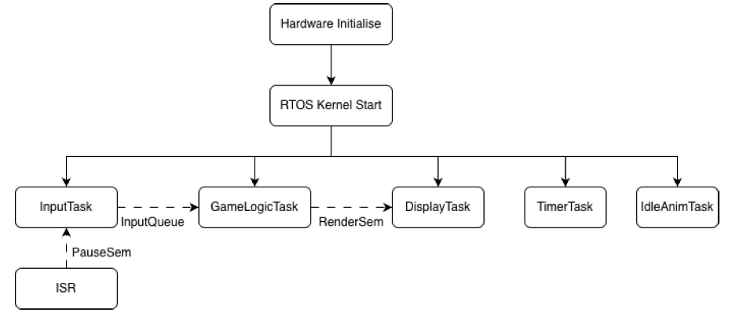
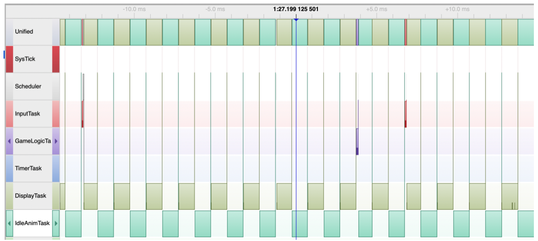

import { url as siteUrl } from "../../config";

Used a Snake game to exercise an analogue joystick, OLED, ADC with DMA and HAL drivers. Coordinated input, game logic and rendering with FreeRTOS tasks, queues, semaphores and mutexes. Checked scheduling and processor utilisation with Segger SystemView and CPU-load measurements.

## Hardware demo

<video
    controls
    playsInline
    preload="metadata"
    className="block w-full max-w-2xl"
    aria-label="Silent gameplay demo on the STM32 development board"
>
    <source src={siteUrl("projects/stm32-freertos/freertos-gameplay-demo.mp4")} type="video/mp4" />
</video>

The silent demo shows the analogue joystick controlling the game on the OLED display.

## Firmware architecture and timing

During recorded gameplay, the input task took approximately 54–109 µs to execute against a nominal 20 ms sampling interval.
