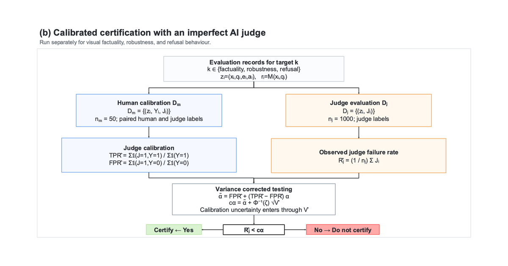

Built an image-QA pipeline for charts, documents, forms, receipts and screenshots. Completed runs supported up to 10,000 images and 30,000 question-answer records. Calibrated imperfect AI judges against human labels with noisy hypothesis testing so judge reliability was explicit in certification decisions.

## Certification workflow

*Thesis Figure 1(b). Human labels calibrate the AI judge, and a variance-corrected test accounts for uncertainty in that calibration when making the certification decision.*
